


🇫🇷 Français · [🇬🇧 English version below](#-english-version)

## 🎓 À propos de moi

Je suis en **Master 1 MIASHS** (mathématiques et informatique appliquées aux sciences humaines et sociales), une formation pluridisciplinaire au métier de **data scientist**. Elle articule mathématiques, statistique et informatique pour modéliser et traiter des données complexes.

🎯 **Mon objectif** : traduire une problématique métier en questions de données, choisir le bon périmètre, concevoir des chaînes de traitement, puis analyser et communiquer les résultats.

## 🛠️ Compétences


## 🚀 Mes projets

<i>Cliquez sur une carte pour ouvrir le projet.</i>

  <a href="https://github.com/Kardiatou102/PairIA"></a>
  <a href="https://github.com/Kardiatou102/Salary_predict"></a>

  <a href="https://github.com/Kardiatou102/Projet_GBSC"></a>
  <a href="https://github.com/Kardiatou102/Projet_depart-ement-"></a>

  <a href="https://github.com/Kardiatou102?tab=repositories"></a>

---

## 🇬🇧 English version

## 🎓 About me

I am in the first year of a **Master's in MIASHS** (applied mathematics and computer science for social sciences), a multidisciplinary program that trains **data scientists**. It combines mathematics, statistics and computer science to model and process complex data.

🎯 **My goal**: turn a business problem into data questions, define the right scope, design data pipelines, then analyze and communicate the results.

## 🛠️ Skills


## 🚀 Projects

<i>Click a card to open the project.</i>

  <a href="https://github.com/Kardiatou102/PairIA"></a>
  <a href="https://github.com/Kardiatou102/Salary_predict"></a>

  <a href="https://github.com/Kardiatou102/Projet_GBSC"></a>
  <a href="https://github.com/Kardiatou102/Projet_depart-ement-"></a>

  <a href="https://github.com/Kardiatou102?tab=repositories"></a>

📫 **Contact** : [LinkedIn](https://www.linkedin.com/in/kardiatou-ba-45709a389/)

